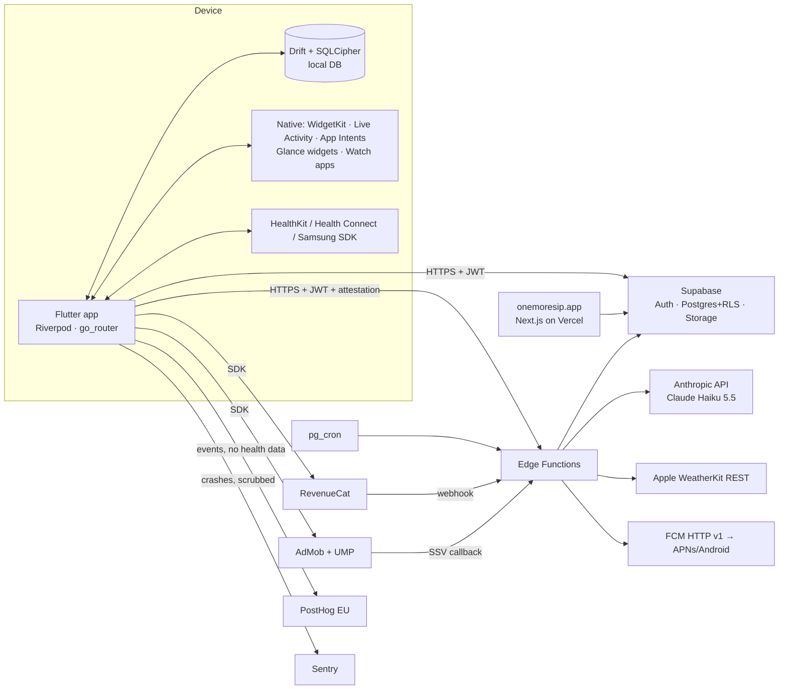

# System Design — One More Sip

> Related: [CLAUDE.md](../CLAUDE.md) · [Decisions](decisions.md) · [PRD](PRD.md) · [Design System](design-system.md) · [Store Compliance](store-compliance.md) · [Tasks](task.md)

Implements PRD v1.0. Section IDs (`SD-x`) are referenced from `task.md`. Package names and versions must be re-checked against pub.dev / official docs when the task starts — this document fixes the *approach*, not the exact version.

---

## SD-1 Architecture overview



Principles: offline-first device, server authoritative for money/quota/family, secrets only server-side, deterministic logic on device (D-22).

---

## SD-2 Tech stack

| Concern | Choice | Notes |
|---|---|---|
| App | Flutter stable via FVM | iOS 16+, Android API 28+ |
| State | `flutter_riverpod` (+ codegen) | |
| Routing | `go_router` | deep links `/i/:token`, `/c/:code` |
| Local DB | `drift` + SQLCipher (`sqlcipher_flutter_libs`) | key in `flutter_secure_storage` |
| Backend | `supabase_flutter` | Auth, PostgREST, Functions |
| Payments | `purchases_flutter` (RevenueCat), `purchases_ui_flutter` optional | custom paywall preferred for design control |
| Ads | `google_mobile_ads` + UMP | non-personalized |
| Local notifications | `flutter_local_notifications` + `timezone` | actions, channels |
| Background | `workmanager` (Android), BGTask (iOS) | reschedule rolling window |
| Push | `firebase_messaging` (FCM only, no Firebase Analytics) | family alerts, insights |
| Health | `health` package; Samsung Health Data SDK via platform channel | |
| Widgets | `home_widget` + native WidgetKit / Glance | App Group / SharedPreferences bridge |
| Live Activity | native ActivityKit (or `live_activities` pkg) | |
| Mascot | `rive` | state machine (DS-8) |
| Fasting times | `adhan` (Dart port) | on-device |
| Location | `geolocator` coarse only | geohash-5 sent to server |
| i18n | `flutter_localizations`, `intl`, ARB | EN, ID, AR, ES, PT |
| Analytics | `posthog_flutter` (EU) | SD-9 |
| Crash | `sentry_flutter` | PII scrubbing |
| Auth UI | Supabase email OTP, `sign_in_with_apple`, `google_sign_in` | |
| Attestation | App Attest / Play Integrity via `app_device_integrity` or native channel | verify package at T-064 |
| Edge Functions | Deno + TypeScript, `zod` | |
| Email | Resend (custom SMTP for Supabase Auth) | |
| Website | Next.js + Vercel | F-36 |

---

## SD-3 Flutter app architecture

### SD-3.1 Folder layout (feature-first)
```
lib/
  main_dev.dart / main_prod.dart        # flavor entry points
  app/            app.dart, router.dart, theme/ (tokens from DS), l10n/
  core/           config/ (constants, goal rules), db/ (drift), sync/, net/, analytics/,
                  flags/, notifications/, health/, ads/, purchases/, security/, utils/
  features/
    onboarding/ home/ logging/ drinks/ reminders/ stats/ streaks/ education/
    fasting/ simple_mode/ family/ kids/ challenges/ ai_photo/ ai_chat/ ai_insight/
    paywall/ account/ privacy/ settings/ widgets_bridge/
      each: data/ (repositories), domain/ (pure logic + models), presentation/ (screens, widgets, controllers)
  l10n/ app_en.arb app_id.arb app_ar.arb app_es.arb app_pt.arb
assets/  drinks/drinks.json  rive/sippy.riv  fonts/  images/
ios/     Runner, WidgetExtension, LiveActivity, AppIntents, WatchApp
android/ app (Glance widgets, Samsung bridge), wear/
supabase/ migrations/ functions/ seed.sql tests/
web/     (Next.js site, separate package)
```

### SD-3.2 Layers
- `domain/`: pure Dart, no Flutter imports, 100% unit-tested (goal calc, catch-up, fasting split, quota display state, streak).
- `data/`: repositories over Drift (local) and Supabase (remote). UI never calls Supabase directly.
- `presentation/`: widgets + Riverpod controllers. Simple Mode is a separate route tree reusing domain/data.

### SD-3.3 Flavors & config
`dev` (Supabase dev project, test ads, RevenueCat sandbox) and `prod`. Config via `--dart-define-from-file=env/dev.json` (public values only).

### SD-3.4 Native bridges
- **App Group** (iOS) / **SharedPreferences + Glance state** (Android) holding: today's hydration, goal, default glass size, theme. Written by the app after every change.
- Widget / Live Activity / notification-action / App Intent quick-add writes a pending log to the shared store; the app imports pending logs into Drift on next foreground or background task. iOS notification actions and interactive widgets run an App Intent that appends to a shared JSON queue.
- Watch apps talk to the phone (WatchConnectivity / Wearable Data Layer) and fall back to their own queue.

---

## SD-4 Data model

### SD-4.1 Postgres (Supabase) — every table has RLS (SD-7)

```sql
-- Account = auth.users. One account owns 1..n profiles (main + managed kids).
create table profiles (
  id uuid primary key default gen_random_uuid(),
  account_id uuid not null references auth.users on delete cascade,
  kind text not null check (kind in ('main','child')),
  display_name text not null,
  birth_year smallint,                    -- children only (age bracket)
  weight_kg numeric(5,1),
  sex text check (sex in ('female','male','unspecified')),
  activity_level text check (activity_level in ('low','moderate','high')),
  wake_time time, sleep_time time,
  timezone text not null,
  units text not null default 'ml',
  locale text not null default 'en',
  experience text not null default 'normal' check (experience in ('normal','simple')),
  fluid_restriction_ml int,               -- sensitive: never shared, never sent to analytics/AI
  goal_override_ml int,
  adaptive_weather boolean not null default true,
  adaptive_activity boolean not null default true,
  updated_at timestamptz not null default now(),
  deleted_at timestamptz
);

create table drink_logs (
  id uuid primary key,                    -- UUIDv7 generated on device
  profile_id uuid not null references profiles on delete cascade,
  drink_id text not null,                 -- from drinks.json or 'custom:<uuid>'
  volume_ml int not null check (volume_ml between 1 and 3000),
  hydration_ml int not null,
  caffeine_mg numeric(6,1), sugar_g numeric(6,1),
  source text not null check (source in ('app','notification','widget','voice','live_activity','watch','ai_photo','health_import')),
  logged_at timestamptz not null,
  updated_at timestamptz not null,
  deleted_at timestamptz
);
create index on drink_logs (profile_id, logged_at);

create table custom_drinks (id uuid primary key, account_id uuid references auth.users on delete cascade,
  name text, icon text, water_pct numeric(4,1), sugar_g_100ml numeric(5,1), caffeine_mg_100ml numeric(6,1),
  updated_at timestamptz, deleted_at timestamptz);

create table daily_goals (profile_id uuid references profiles on delete cascade, day date,
  base_ml int, weather_ml int, activity_ml int, final_ml int, reason jsonb,
  primary key (profile_id, day));

create table reminder_settings (profile_id uuid primary key references profiles on delete cascade,
  mode text, interval_min int, fixed_times time[], weekdays jsonb, quiet_start time, quiet_end time,
  skip_if_logged_min int default 30, vibration_pattern text, text_style text, updated_at timestamptz);

create table fasting_settings (profile_id uuid primary key references profiles on delete cascade,
  enabled boolean, type text, custom_days jsonb, if_window jsonb, calc_method text,
  split_pattern text default '2-4-2', updated_at timestamptz);

-- Money & quota: written only by service role (edge functions / security definer RPC)
create table entitlements (account_id uuid primary key references auth.users on delete cascade,
  premium boolean not null default false, family boolean not null default false,
  remove_ads boolean not null default false, in_trial boolean not null default false,
  premium_source text, expires_at timestamptz, rc_app_user_id text, updated_at timestamptz);

create table ai_usage (account_id uuid references auth.users on delete cascade, period text,  -- 'YYYY-MM'
  photo_used int default 0, chat_used int default 0, primary key (account_id, period));
create table ai_usage_daily (account_id uuid references auth.users on delete cascade, day date,
  photo_used int default 0, chat_used int default 0, primary key (account_id, day));
create table ai_credits (account_id uuid primary key references auth.users on delete cascade,
  photo_balance int default 0, chat_balance int default 0);
create table store_transactions (transaction_id text primary key, account_id uuid, product_id text,
  kind text, processed_at timestamptz default now());           -- idempotency for top-ups
create table ai_insights (profile_id uuid references profiles on delete cascade, week_start date,
  content jsonb, primary key (profile_id, week_start));

create table rewards (account_id uuid primary key references auth.users on delete cascade,
  streak_freezes int default 1, theme_unlock_until timestamptz);
create table admob_ssv_events (transaction_id text primary key, account_id uuid, reward text, created_at timestamptz default now());

-- Family
create table families (id uuid primary key default gen_random_uuid(), owner_account uuid not null references auth.users, created_at timestamptz default now());
create table family_members (family_id uuid references families on delete cascade,
  account_id uuid references auth.users on delete cascade, role text check (role in ('owner','member')),
  share_progress boolean not null default false,      -- explicit consent
  allow_remote_setup boolean not null default false,  -- explicit consent
  consented_at timestamptz, primary key (family_id, account_id));
create table family_invites (token_hash text primary key, family_id uuid references families on delete cascade,
  created_by uuid, expires_at timestamptz not null, used_at timestamptz);
create table caregiver_rules (id uuid primary key default gen_random_uuid(), family_id uuid references families on delete cascade,
  watcher_account uuid, member_profile uuid references profiles on delete cascade,
  no_log_hours smallint not null default 3, enabled boolean default true, last_alert_at timestamptz);

-- Challenges
create table challenges (id uuid primary key default gen_random_uuid(), owner_account uuid, name text,
  invite_code text unique, starts_on date, ends_on date);
create table challenge_members (challenge_id uuid references challenges on delete cascade,
  account_id uuid references auth.users on delete cascade, display_name text, primary key (challenge_id, account_id));

-- Platform
create table push_tokens (token text primary key, account_id uuid references auth.users on delete cascade,
  platform text, updated_at timestamptz);
create table feature_flags (key text primary key, enabled boolean not null, min_build int, platforms text[]);
create table weather_cache (geohash5 text, day date, max_feels_c numeric(4,1), humidity_pct smallint,
  altitude_m int, fetched_at timestamptz, primary key (geohash5, day));
```

Views / RPC (security definer, with explicit auth checks):
- `family_member_status(family_id)` → member display name, progress %, goal_met, last_log_at (BR-08). Only for members with `share_progress = true`.
- `challenge_leaderboard(challenge_id)` → display name, % of goal per day.
- `consume_ai_quota(kind)` → atomic; see SD-6.2.
- `my_entitlement()` → read-only snapshot.

### SD-4.2 Local (Drift)
Mirrors `profiles`, `drink_logs`, `custom_drinks`, `daily_goals`, `reminder_settings`, `fasting_settings`, plus:
- `outbox(id, table, row_id, op, payload, created_at, attempts)` — pending sync writes.
- `sync_state(table, last_pulled_at)`.
- `cached_entitlement`, `cached_quota` — display only, never authoritative.
- `pending_external_logs` — imported from widget/notification/watch queues.
Guest mode uses the same schema with a local `account_id = 'guest'`; on sign-up rows are re-keyed and pushed.

---

## SD-5 Sync (offline-first)

1. Every write goes to Drift + an `outbox` row in one transaction.
2. Push: on connectivity/foreground/background task, send outbox batches via PostgREST `upsert` (≤ 200 rows). Server trigger sets `updated_at = now()` on receipt.
3. Pull: `select * where updated_at > last_pulled_at` per table, paginated.
4. Conflicts: last-write-wins by server `updated_at`. Logs are near append-only, so conflicts are rare; deletes are soft (`deleted_at`) and purged after 30 days.
5. IDs are UUIDv7 from the device, so retries are idempotent.
6. Family-shared data is never synced to other devices as raw rows; caregivers read the RPC in SD-4.1.

---

## SD-6 Server logic (Edge Functions & RPC)

| Function | Trigger | Responsibility |
|---|---|---|
| `ai-photo` | app | attest → auth → entitlement → quota → resize check → model → JSON validate → return + remaining quota |
| `ai-chat` | app | same pipeline, text; history ≤ last 6 turns sent by client, truncated server-side |
| `ai-insight-weekly` | pg_cron Mon 06:00 per TZ bucket | aggregate stats → model → `ai_insights` → push digest |
| `revenuecat-webhook` | RevenueCat | verify `Authorization` secret → upsert `entitlements`; family propagation; top-up credit (idempotent via `store_transactions`) |
| `admob-ssv` | AdMob | verify ECDSA signature against Google's key set → grant reward once (`admob_ssv_events`) |
| `weather` | app (daily) | geohash5 → `weather_cache` or WeatherKit REST (JWT signed with Apple key) → returns max feels-like, humidity, altitude + attribution |
| `family-invite` | app | create (random 32-byte token, store SHA-256 hash, 72 h), accept (consent flags), revoke |
| `caregiver-check` | pg_cron every 15 min | evaluate `caregiver_rules` inside member waking window → push, max 1 alert per rule per 3 h |
| `push-send` | internal | FCM HTTP v1 with service account; removes dead tokens |
| `account-delete` | app / website | verify → delete storage, rows (cascade), RevenueCat subscriber alias note, auth user |
| `data-export` | app | JSON/CSV of the account's own data |

### SD-6.1 Entitlements
- App identifies to RevenueCat with `appUserID = auth.uid()` once signed in (guests use anonymous RC IDs, aliased on sign-up).
- UI may read RevenueCat `CustomerInfo` for instant feedback, but **all server features check `entitlements`**.
- Family: owner's `family` entitlement → webhook sets `premium = true, premium_source = 'family:<family_id>'` for every member; removal on expiry or member leave.
- Trial: `in_trial = true` from RC event `period_type = TRIAL`.

### SD-6.2 AI quota (BR-05)
`consume_ai_quota(kind)` in one transaction:
1. Require entitlement premium (else `402`).
2. Lock rows `ai_usage(period)` and `ai_usage_daily(day)` (`select … for update`, upsert if missing).
3. If daily cap reached → `429 daily_cap`.
4. Monthly limit = trial ? 10 : 150/60. If under → increment monthly; else if `ai_credits` balance > 0 → decrement credits; else `402 quota_empty`.
5. Increment daily. Return `{monthly_left, credits_left, daily_left, resets_at}`.
If the model call fails afterwards, a compensating `refund_ai_quota` restores the unit.

### SD-6.3 Weekly insight input (no identity)
`{locale, goal_ml_avg, days_met, avg_ml, by_hour_histogram, drink_category_share, caffeine_avg_mg, sugar_avg_g, fasting_days, fluid_restricted:bool}` — when `fluid_restricted` the prompt forbids "drink more" advice.

### SD-6.4 Rewarded ads
Client shows rewarded ad with `customData = account_id` (or a signed nonce for guests) → AdMob SSV → `admob-ssv` grants. Client polls `rewards` after the ad closes. Guests: reward granted locally only (low value, acceptable).

---

## SD-7 Security

**Secrets**: only in Supabase function secrets: `ANTHROPIC_API_KEY`, `WEATHERKIT_KEY_P8`, `WEATHERKIT_KEY_ID`, `APPLE_TEAM_ID`, `FCM_SERVICE_ACCOUNT`, `REVENUECAT_WEBHOOK_SECRET`, `PLAY_INTEGRITY_*`, `RESEND` (via Supabase SMTP settings). Never in the repo; `.env*` git-ignored; secret scanning in CI.

**AuthN/AuthZ**
- Supabase JWT on every request; short-lived access tokens, refresh tokens in secure storage.
- RLS on every table. Pattern: `profiles.account_id = auth.uid()`; child tables join through `profiles`. Money/quota/flags tables: `select` own row only, **no insert/update/delete** for `authenticated` — only `service_role`.
- Caregiver access only via security-definer RPC that checks `family_members` consent flags.
- RLS test suite (`supabase/tests/*.sql` with pgTAP) for every table: owner can, stranger can't, family member only via RPC.

**Abuse protection**
- App Attest (iOS) / Play Integrity (Android) token required by `ai-*`, `weather`, `family-invite`; verified server-side; dev builds use a debug allowlist.
- Rate limits per account per minute in `ai-*` (e.g. 6/min) on top of daily caps; global monthly budget alarm + hard cap set in the Anthropic console.
- `max_tokens` per request (photo 300, chat 500, insight 600).
- Input limits: image ≤ 1.5 MB after on-device resize, chat message ≤ 1,000 chars.

**AI safety**
- No tool use; structured output validated by zod; unknown fields dropped; on validation failure → generic error, quota refunded.
- System prompts treat user text and image text as data; never reveal prompts; refuse medical diagnosis; honor fluid restriction.
- No identity (name, email) sent to the model.

**Data protection**
- Local DB encrypted (SQLCipher) with key in Keychain/Keystore; screenshots allowed (accessibility) but sensitive screens (fluid restriction) can be blurred in app switcher.
- TLS only; certificate pinning not used (Supabase/CDN rotation risk) — rely on attestation + TLS.
- Logs (Sentry, function logs) never include health values, photos, chat text, emails, tokens.
- Account deletion removes all rows (cascade) within 30 days max; immediate for app-initiated deletion.
- Build: `flutter build --obfuscate --split-debug-info`; R8 on Android; dependency audit (`dart pub outdated`, `osv-scanner`) in CI.

**Deep links**: invite tokens are single-use, hashed at rest, 72 h expiry, accepting requires sign-in + explicit consent screen.

---

## SD-8 Notifications & background

- **Local reminders** (primary): scheduled on device from `reminder_settings` + today's state.
  - iOS: max 64 pending → keep a rolling window of the next ~36 h; refresh on foreground, on every log, on BGAppRefresh, and from widget timeline reloads.
  - Android: channels per category (PRD F-06); inexact alarms by default; `SCHEDULE_EXACT_ALARM` optional with in-app rationale; `RECEIVE_BOOT_COMPLETED` to reschedule; WorkManager daily re-plan.
  - Smart skip (BR-09) is evaluated when planning **and** at fire time where the OS allows (Android: check in receiver; iOS: re-plan on each log).
- **Actions**: "✓ 250 ml" logs without opening the app (iOS: notification action handled by App Intent / background handler; Android: broadcast receiver → pending log queue). "Later" re-schedules +15 min.
- **Remote push (FCM)**: family alerts, weekly insight digest, weather goal change. Payloads contain no health values ("Check on Mom's hydration" not "Mom drank 300 ml").
- **Notification health check**: permission status, channel enabled, battery optimization (Android `isIgnoringBatteryOptimizations`), manufacturer auto-start hints per brand (link to an in-app guide page per brand), exact-alarm status, last fired reminder vs expected.
- **Time changes**: listen for time-zone/clock changes → re-plan.

---

## SD-9 Analytics, logging & privacy

- PostHog (EU cloud), autocapture off, session replay off, IP anonymized; distinct ID = random install ID (not email).
- Allowed events: `app_opened`, `onboarding_step_completed{step}`, `onboarding_completed{experience}`, `drink_logged{source}`, `reminder_action{action}`, `day_completed{goal_met:boolean}`, `feature_discovered{feature}`, `paywall_viewed{placement}`, `purchase_started{product}`, `ad_reward_claimed{reward}`, `notification_health_fixed{issue}`, `fasting_mode_enabled{type}`, `family_invite_sent`, `family_invite_accepted`, `ai_used{kind}`, `quota_state{state}`.
- **Forbidden properties**: volumes, drink IDs, goals, weight, fluid restriction, location, chat text.
- Consent: analytics opt-out toggle in Privacy center; EEA default follows UMP choice.
- Revenue analytics from RevenueCat Charts.
- Disclose all of the above in App Privacy labels and Play Data Safety (SC-13).

---

## SD-10 AI design

- **Provider abstraction** in `supabase/functions/_shared/ai.ts`: `generateJson({task, system, input, schema, maxTokens})`. Model config: `AI_MODEL=claude-haiku-5-5` (D-09). Swapping provider = new adapter, no app update.
- **Prompt caching** for static system prompts.
- **Photo task schema**:
```json
{ "drink_match": "string (drink_id from candidates or 'custom')",
  "name": "string", "volume_ml": "int 30-2000", "sugar_g": "number|null",
  "caffeine_mg": "number|null", "confidence": "low|medium|high", "notes": "string<=80" }
```
  The function sends a compact candidate list (id + English name) of drinks for the user's country + global, so answers map to `drinks.json`.
- **Chat**: system prompt with persona Sippy, scope = hydration, safety rules, locale; reply ≤ 120 words.
- **Insight**: SD-6.3 input → `{headline, observations[3], tip}`.
- **Evaluation set** (T-114): 50 real drink photos incl. local drinks; target ≥ 80% correct category, volume within ±30%.

Cost guard (Haiku 5.5 $0.10/$0.50 per MTok): worst-case premium user ≈ Rp1.300/month (BR-05 full usage). Budget alarm at 150% of forecast.

---

## SD-11 Environments, CI/CD & release

- Supabase projects: `oms-dev`, `oms-prod` (region per Q-04). Migrations in git; `supabase db push` only from CI to prod.
- Git: trunk-based, short-lived branches, Conventional Commits.
- CI (GitHub Actions): format, analyze, unit/widget tests, pgTAP RLS tests, edge function tests (deno test), secret scan, dependency audit.
- CD: Fastlane (or Codemagic) → TestFlight + Play internal track on tag. Build numbers from CI.
- Release channels: Play internal → closed test (≥ 12 testers, 14 days, D-18) → production staged rollout 10% → 50% → 100%. iOS: TestFlight → phased release.
- Kill switches: `feature_flags` fetched at start + every 6 h; cached; default ON for reviewed features.

---

## SD-12 Testing strategy

| Layer | What | Tool |
|---|---|---|
| Unit | BR-01..BR-09, sync merge, quota display, fasting windows (incl. DST, high latitude), streak | `test` |
| Widget | onboarding, log + undo, Simple Mode, paywall, quota states, RTL Home, 200% text | `flutter_test`, golden tests |
| Integration | log from notification, offline → online sync, purchase sandbox, restore | `integration_test` on devices |
| DB | RLS per table, RPC permission checks, quota concurrency | pgTAP |
| Edge | each function happy path + auth fail + attestation fail + quota edge | `deno test` |
| Manual matrix | reminder reliability 30 days: Xiaomi, Oppo, Vivo, Samsung, Realme, Pixel, iPhone (owner) | checklist T-160 |
| Accessibility | VoiceOver/TalkBack walkthrough, contrast, 200% text | manual + golden |

---

## SD-13 Running costs & monitoring

Fixed ≈ Rp1–2 juta/month (Supabase Pro, Apple Developer amortized, domain, Resend free/low tier, Sentry free tier, PostHog free tier). Variable: AI (SD-10), RevenueCat 1% above $2.5k MTR.
Monitoring: Sentry alerts (crash spike), Supabase function error rate, Anthropic spend alarm, RevenueCat webhook failures, daily `caregiver-check` heartbeat.
